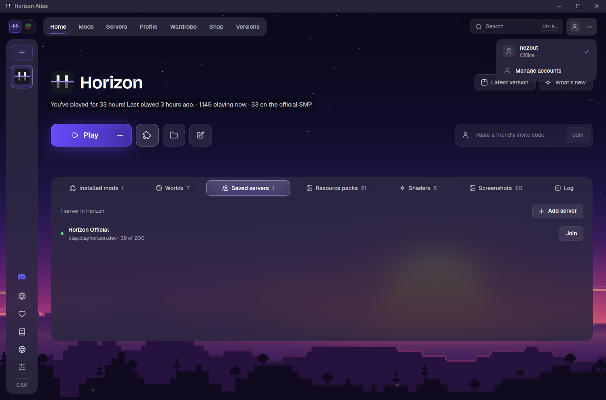

# Horizon Atlas

**Play Horizon offline.** Horizon Atlas is a launcher for [Horizon](https://github.com/horizon-rust/horizon), Minecraft:
Java Edition 26.3 rewritten in Rust. It plays without a Microsoft account sign-in, prepares the game from your own copy
of Minecraft, and keeps up with every Horizon launcher release.

[](https://github.com/nezbut/horizon-atlas/releases/latest)
[](https://github.com/nezbut/horizon-atlas/releases)
[](#install)

**Download:** [Windows](https://github.com/nezbut/horizon-atlas/releases/latest/download/horizon-launcher-setup.exe) ·
[Windows ARM](https://github.com/nezbut/horizon-atlas/releases/latest/download/horizon-launcher-setup-arm64.exe) ·
[Linux (AppImage)](https://github.com/nezbut/horizon-atlas/releases/latest/download/horizon-launcher-linux-x86_64.AppImage) ·
[macOS (Apple Silicon)](https://github.com/nezbut/horizon-atlas/releases/latest/download/horizon-launcher-macos-arm64.dmg) ·
[macOS (Intel)](https://github.com/nezbut/horizon-atlas/releases/latest/download/horizon-launcher-macos-x64.dmg) ·
[all files](https://github.com/nezbut/horizon-atlas/releases/latest)

<p align="center">
  
</p>

> **Unofficial.** Made by a player. Not affiliated with, endorsed by or supported by Horizon's authors, Mojang or
> Microsoft: ask for help in this repository's [issues](https://github.com/nezbut/horizon-atlas/issues), not on
> Horizon's channels. You need your own copy of Minecraft: Java Edition.

## Features

- **Offline play, no Microsoft account.** Pick a player name and press Play.
- **Your own Minecraft, found or chosen.** Atlas finds Minecraft 26.3 in the launchers on your computer, or you pick its `26.3.jar` with **Choose jar…**.
- **All of Horizon.** The game is Horizon's, unmodified: your worlds, mods, resource and shader packs, the fast native renderer ([Horizon's README below](#horizon)).
- **Always current.** Each Horizon launcher release becomes an Atlas release, usually within hours, and the launcher updates itself.
- **Signed updates.** Every update is checked against Atlas's signing key before it is installed.

## Install

- **Windows:** run `horizon-launcher-setup.exe` (`horizon-launcher-setup-arm64.exe` on ARM). It is not code-signed, so SmartScreen may say "Windows protected your PC": choose **More info**, then **Run anyway**.
- **Linux (x86-64) and macOS (Apple Silicon)**, from a terminal:

  ```sh
  curl -fsSL https://raw.githubusercontent.com/nezbut/horizon-atlas/main/install.sh | sh
  ```

  It installs for your user only and puts `horizon-atlas` in `~/.local/bin`. Or take the AppImage (Linux) or the `.dmg` (macOS, Intel too) from the links above.
- **macOS:** the app is not notarized, so macOS may refuse to open it the first time. Right-click it and choose **Open**, or run `xattr -dr com.apple.quarantine "<path to the app>"` (`install.sh` already does this).

## First run

1. Have Minecraft: Java Edition 26.3 installed once, in any launcher (the official one, Prism, Modrinth App and others work).
2. Open Atlas and press **Prepare**. It finds your copy of 26.3 and prepares the game from it. If it cannot, press **Choose jar…** and pick `versions/26.3/26.3.jar` in the folder of the launcher that downloaded 26.3, so that its `libraries` and `assets` are found too.
3. Pick a player name and press **Play**.

## FAQ

**Do I need to own Minecraft?** Yes. Atlas prepares the game from your own copy of Minecraft: Java Edition 26.3 and never downloads Minecraft for you. The jar must be the 26.3 release, with the `libraries` and `assets` its launcher downloaded next to it; a jar on its own fails with a "Missing …/libraries/…" error.

**Can I play on servers?** In single player, in LAN worlds and on servers that run in offline mode, yes. Online-mode servers (most public ones) check a Microsoft account, and Atlas has no Microsoft sign-in, so they turn you away.

**Will my worlds work?** Horizon opens vanilla saves as they are and upgrades worlds from 1.8 to 26.2.

**Is it safe?** The source is open, every release is built by GitHub Actions from this repository, and the launcher installs an update only if its signature checks out. The Windows warning only means the installer has no paid code-signing certificate.

**Mods and shader packs?** As in Horizon: install them from the launcher's Mods page.

**Can I keep the official Horizon launcher too?** On Linux, yes: Atlas installs as its own program, and both share your worlds and settings. On Windows, Atlas currently installs into the official launcher's place and replaces it. On macOS this has not been checked yet.

## For developers: how Atlas stays in sync

Atlas is a short list of small commits (patches: `offline-play`, `choose-jar`, `own-releases`, `own-keys`, `branding`) on top of one of Horizon's `launcher@X.Y.Z` tags.
Four times a day a workflow checks for a newer Horizon launcher tag, replays the patches onto it, tests, and publishes a release. If a patch no longer applies, nothing is published and an issue names the patch.
Atlas's versions are its own (`0.x`); each release title says which Horizon launcher it is based on.

## License

MIT, like Horizon (see [LICENSE](LICENSE)). Horizon is by Ludovic Marie and the Horizon contributors; Atlas is built on their work. See [THIRD_PARTY_NOTICES.md](THIRD_PARTY_NOTICES.md) for other credits.

---

*Below is Horizon's own README, unchanged.*

<p align="center">
  <picture>
    <source media="(prefers-color-scheme: dark)" srcset="docs/media/readme/title-dark.png">
    
  </picture>
</p>

<p align="center">
  <b>Minecraft 26.3, rewritten from scratch in Rust.</b><br>
  Play on existing worlds and servers.
</p>

<p align="center">
  <a href="https://playhorizon.dev/download"></a><br>
  <sub>You need your own copy of Minecraft: Java Edition.</sub>
</p>

<p align="center">
  <a href="https://playhorizon.dev/docs/install"><b>Install guide</b></a> ·
  <a href="https://playhorizon.dev/docs/"><b>Docs</b></a> ·
  <a href="https://playhorizon.dev/mods"><b>Mods</b></a> ·
  <a href="https://discord.gg/playhorizon"><b>Discord</b></a>
</p>

<p align="center">
  
</p>

<p align="center">
  
</p>

<p align="center">
  <sub>*Against Java Edition with Sodium, Lithium, FerriteCore and ImmediatelyFast on a Ryzen 7 9800X3D with an RTX 5080. More computers on the <a href="https://playhorizon.dev/benchmarks">benchmarks page</a>.</sub>
</p>

<h2 align="center">What you get</h2>

- **Vanilla Minecraft:** survival, creative and hardcore in every dimension, with the same terrain, mobs, villagers and redstone. Your saves open as they are.
- **Multiplayer:** vanilla and Horizon servers, LAN, and invite codes for playing your world with friends. You can [host a server](https://playhorizon.dev/docs/hosting) too.
- **Mods:** Horizon's own mod system, with mods like zoom and a minimap, and shader packs. Browse the [catalogue](https://playhorizon.dev/mods) or [make a mod](https://playhorizon.dev/docs/make-a-mod).
- **Beyond vanilla:** terrain up to 1,024 chunks away, HDR, controller support, graphics presets and dynamic lights.
- **Dedicated server:** Server software for high performance, low memory usage, and near instant startup. See [the server benchmark](docs/performance/server-vs-vanilla.md).

<h2 align="center">What you need</h2>

- **Your own copy of Minecraft: Java Edition.** Horizon ships no Minecraft files. It builds them from the game you bought, so install version 26.3 and start it once.
- **Windows, macOS or Linux:** Windows on x64 or ARM64, macOS 12 or later, Linux on x86-64.

<h2 align="center">Made by the Horizon Team</h2>

<table align="center">
  <tr>
    <td align="center" width="140"><a href="https://github.com/kacpherek"><br><b>Kacper</b></a></td>
    <td align="center" width="140"><a href="https://github.com/Online5277"><br><b>Cosmic</b></a></td>
    <td align="center" width="140"><a href="https://github.com/levzzz5154"><br><b>levzzz</b></a></td>
    <td align="center" width="140"><a href="https://github.com/rdbtCVS"><br><b>rdbt</b></a></td>
    <td align="center" width="140"><a href="https://github.com/dezer-x"><br><b>Anthony S</b></a></td>
    <td align="center" width="140"><a href="https://github.com/NikitaMGrimm"><br><b>Nikita</b></a></td>
    <td align="center" width="140"><a href="https://github.com/ludovic111"><br><b>Ludovic Marie</b></a><br><sub>Founder</sub></td>
  </tr>
</table>

<p align="center">
  <sub>and everyone who has contributed</sub><br><br>
  <a href="https://github.com/horizon-rust/horizon/graphs/contributors"></a>
</p>

<p align="center">
  <a href="https://blacksmith.sh"></a>
</p>

<p align="center">
  <a href="docs/native-client.md#run-from-a-checkout"><b>Build guide</b></a> ·
  <a href="CONTRIBUTING.md"><b>Contributing</b></a> ·
  <a href="GOVERNANCE.md"><b>Governance</b></a> ·
  <a href="https://github.com/sponsors/ludovic111"><b>Sponsor</b></a>
</p>

<sub>Horizon is released under the [GNU LGPL, version 3 or later](LICENSE), for the project's original work. Code merged before the move from MIT stays available under the [MIT licence](LICENSES/MIT.txt). Dependencies keep their own licences, see the [notices](THIRD_PARTY_NOTICES.md). Founded by [Ludovic Marie](https://lu4ovic.com) and built by the Horizon Team and [its contributors](https://github.com/horizon-rust/horizon/graphs/contributors). You can support it on [GitHub Sponsors](https://github.com/sponsors/ludovic111).</sub>

<sub>NOT AN OFFICIAL MINECRAFT PRODUCT. NOT APPROVED BY OR ASSOCIATED WITH MOJANG OR MICROSOFT. Minecraft is a trademark of Mojang Synergies AB; its code and assets belong to Mojang and Microsoft under the [Minecraft EULA](https://www.minecraft.net/en-us/eula).</sub>
