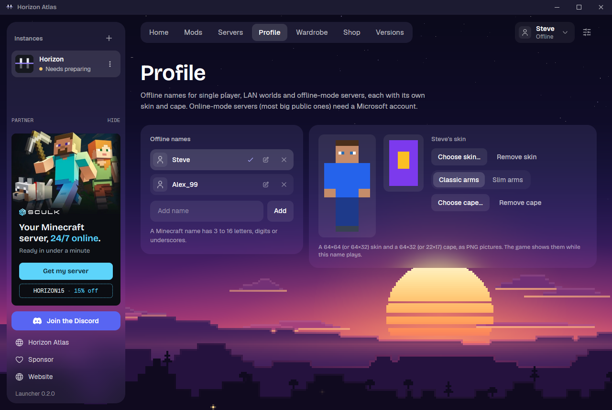

<h1 align="center">Horizon Atlas</h1>

<p align="center">
  <b>Play <a href="https://github.com/horizon-rust/horizon">Horizon</a> without a Microsoft account.</b><br>
  A launcher for Horizon, Minecraft: Java Edition 26.3 rewritten in Rust: offline player names with your own skins
  and capes, the game prepared from your own copy of Minecraft, and every Horizon launcher release within hours.
</p>

<p align="center">
  <a href="https://github.com/nezbut/horizon-atlas/releases/latest/download/horizon-launcher-setup.exe"></a>
</p>

<p align="center">
  Other systems:
  <a href="#linux-and-macos">Linux</a> ·
  <a href="#linux-and-macos">macOS</a> ·
  <a href="https://github.com/nezbut/horizon-atlas/releases/latest/download/horizon-launcher-setup-arm64.exe">Windows on ARM</a> ·
  <a href="https://github.com/nezbut/horizon-atlas/releases/latest">all files</a>
</p>

<p align="center">
  <a href="#windows">How to install</a> · <a href="#first-run">First run</a> · <a href="#faq">FAQ</a> · <a href="README.ru.md"><b>Русский</b></a>
</p>

<p align="center">
  <a href="https://github.com/nezbut/horizon-atlas/releases/latest"></a>
  <a href="https://github.com/nezbut/horizon-atlas/releases"></a>
  
  
  <a href="#license"></a>
</p>

<p align="center">
  
</p>

> **Unofficial.** Made by a player. Not affiliated with, endorsed by or supported by Horizon's authors, Mojang or
> Microsoft: ask for help in this repository's [issues](https://github.com/nezbut/horizon-atlas/issues), not on
> Horizon's channels. You need your own copy of Minecraft: Java Edition.

## Features

- **Offline profiles, no Microsoft account.** In the **Profile** tab, add your player names, give each its own skin and cape, and pick who plays. From a terminal: `horizon-atlas offline list`, `add`, `select`, `rename`, `remove`, `skin`, `cape` if you installed with `install.sh` on Linux or macOS (it links `horizon-atlas` into `~/.local/bin`); otherwise run the launcher's own program with `offline …`.
- **Beside the official launcher.** Atlas installs as its own program, so the official Horizon launcher can stay installed next to it.
- **Your own Minecraft, found or chosen.** Atlas finds Minecraft 26.3 in the launchers on your computer, or you pick its `26.3.jar` with **Choose jar…**.
- **All of Horizon.** The game is Horizon's, unmodified: your worlds, mods, resource and shader packs, the fast native renderer ([Horizon's README below](#horizon)).
- **Always current.** Each Horizon launcher release becomes an Atlas release, usually within hours, and the launcher updates itself.
- **Signed updates.** Every update is checked against Atlas's signing key before it is installed.

## Install

### Windows

1. Download **[horizon-launcher-setup.exe](https://github.com/nezbut/horizon-atlas/releases/latest/download/horizon-launcher-setup.exe)**
   (the purple button at the top is the same file). A PC with an ARM processor (Snapdragon and the like: Settings →
   System → About → System type says "ARM-based processor") takes
   **[horizon-launcher-setup-arm64.exe](https://github.com/nezbut/horizon-atlas/releases/latest/download/horizon-launcher-setup-arm64.exe)** instead.
2. Open the downloaded file. Windows may say **"Windows protected your PC"**: the installer has no paid code-signing
   certificate, that's all. Click **More info**, then **Run anyway**.
3. Click **Install**. It installs **Horizon Atlas Launcher** for your Windows account only, in
   `%LOCALAPPDATA%\Programs\Horizon Atlas Launcher`, without administrator rights, with a Start menu entry (and a
   desktop one if **Desktop shortcut** is ticked).
4. Click **Launch Horizon Atlas** and go on with [First run](#first-run).

From then on Atlas updates itself: no need to download it again.

### Linux and macOS

On Linux (x86-64) and macOS (Apple Silicon), from a terminal:

```sh
curl -fsSL https://raw.githubusercontent.com/nezbut/horizon-atlas/main/install.sh | sh
```

It installs for your user only and puts `horizon-atlas` in `~/.local/bin`. Or download the file yourself: the
[AppImage](https://github.com/nezbut/horizon-atlas/releases/latest/download/horizon-launcher-linux-x86_64.AppImage) on
Linux, the `.dmg` for [Apple Silicon](https://github.com/nezbut/horizon-atlas/releases/latest/download/horizon-launcher-macos-arm64.dmg)
or [Intel](https://github.com/nezbut/horizon-atlas/releases/latest/download/horizon-launcher-macos-x64.dmg) on macOS.

On macOS the app is **Horizon Atlas**. It is not notarized, so macOS may refuse to open it the first time: right-click
it and choose **Open**, or run `xattr -dr com.apple.quarantine "<path to the app>"` (`install.sh` already does this).

## First run

1. Have Minecraft: Java Edition 26.3 installed once, in any launcher (the official one, Prism, Modrinth App and others work).
2. Open Atlas and press **Prepare**. It finds your copy of 26.3 and prepares the game from it. If it cannot, press **Choose jar…** and pick `versions/26.3/26.3.jar` in the folder of the launcher that downloaded 26.3, so that its `libraries` and `assets` are found too.
3. In the **Profile** tab, add a player name (and a skin and a cape, if you like), then press **Play**.

## New in 0.2.0: Atlas's own offline play

Since its version 0.2.59, the official Horizon launcher plays only with a Microsoft account that owns Minecraft: its
offline names are gone (the game itself still plays offline). From 0.2.0 on, Atlas no longer switches the official
launcher's offline mode on; it keeps offline play in a layer of its own:

- **The Profile tab** (new): several offline player names, one of them plays. Each name has its own skin, with classic
  or slim arms, and its own cape, as PNG pictures. Add, rename and remove names there.
- **The account menu** (top right) shows who plays and switches between your names.
- **Atlas's own data:** names, skins, capes and Atlas's accounts live in Atlas's own folder, apart from the official
  launcher's. Names, skins and capes from Atlas 0.1.x are copied over on the first start ([details](#coming-from-atlas-01x)).
- **Its own install:** Atlas installs beside the official launcher instead of over it ([Install](#install)).

The game shows your skin and cape to you; other players see the default skin.

<p align="center">
  
</p>

### Coming from Atlas 0.1.x

Atlas updates itself to 0.2.0 as usual, and your worlds and settings stay where they are. Your offline names, the one you play as, and their skins and capes are copied into Atlas's own folder when Atlas 0.2.0 first starts, from the data folder it shares with the official Horizon launcher. The official launcher no longer has offline names: if its version 0.2.59 or newer was used to **Play** before that, it may already have removed them from the shared files, and then they can't be brought back.

Atlas 0.1.x also took the official launcher's place; to move it to its own:

- **Windows:** run the new `horizon-launcher-setup.exe`. It installs Horizon Atlas Launcher in its own folder, and its option **Remove the old Horizon Atlas install (from the Horizon Launcher folder)** (ticked) removes the old copy from the official launcher's folder. Your worlds and settings stay. Remove the old copy this way, not with the old "Horizon Launcher" entry in Windows' installed apps. Until you move, Atlas reminds you when it starts (or choose **Don't show again**).
- **Linux:** nothing to do: the menu entry becomes **Horizon Atlas** by itself.
- **macOS:** an update keeps the old app's name (`Horizon`). To get **Horizon Atlas**, quit Atlas first, then install again: `install.sh` replaces the old app in `~/Applications/Horizon Atlas` by itself; with the new `.dmg` or zip, move the old **Horizon** app to the Trash afterwards (unless it is the official launcher, which has the same name). If you pinned the old app to the Dock, you may need to pin the new one again.

## FAQ

**Do I need to own Minecraft?** Yes. Atlas prepares the game from your own copy of Minecraft: Java Edition 26.3 and never downloads Minecraft for you. The jar must be the 26.3 release, with the `libraries` and `assets` its launcher downloaded next to it; a jar on its own fails with a "Missing …/libraries/…" error.

**Can I play on servers?** In single player, in LAN worlds and on servers that run in offline mode, yes. Online-mode servers (most public ones) check a Microsoft account, and Atlas doesn't support Microsoft sign-in yet, so they turn you away. Horizon is Minecraft 26.3, so a server must let 26.3 players in (a 26.3 server, or an older one with an up-to-date ViaVersion). Other players there see your offline skin only if the server has a skin plugin.

**Can I sign in with Microsoft?** Not yet. Atlas keeps its own accounts, apart from the official launcher's, and shows a short note where a Microsoft sign-in would start.

**Will my worlds work?** Horizon opens vanilla saves as they are and upgrades worlds from 1.8 to 26.2.

**Is it safe?** The source is open, every release is built by GitHub Actions from this repository, and the launcher installs an update only if its signature checks out. The Windows warning only means the installer has no paid code-signing certificate.

**Mods and shader packs?** As in Horizon: install them from the launcher's Mods page.

**Can I keep the official Horizon launcher too?** Yes, side by side. Atlas is its own program (Horizon Atlas Launcher on Windows, Horizon Atlas in the Linux menu and on macOS), and both launchers share your worlds and settings. Their accounts stay apart.

## For developers: how Atlas stays in sync

Atlas is a short list of small commits (patches: `choose-jar`, `own-releases`, `own-keys`, `branding`, `offline`, `no-sign-in`, `own-install`) on top of one of Horizon's `launcher@X.Y.Z` tags.
Four times a day a workflow checks for a newer Horizon launcher tag, replays the patches onto it, tests, and publishes a release. If a patch no longer applies, nothing is published and an issue names the patch.
Atlas's versions are its own (`0.x`); each release title says which Horizon launcher it is based on.

The everyday commands are in `Taskfile.yml` ([go-task](https://taskfile.dev)). The sync tool runs through
[uv](https://docs.astral.sh/uv/) (`uv run tools/atlas_sync.py <command>`), which brings the Python 3.11+ it needs:

- `task check`: every check (formatting, clippy, the launcher's tests, the sync tool's tests, actionlint).
- `task status`: the Horizon launcher tag Atlas is on, a newer one if there is, and Atlas's next version.
- `task rehearse -- <ref>`: replay the patches onto an upstream ref in a scratch clone, leaving yours alone.
- `task clone:sync`: bring your clone's `main` up to date after a sync.
- `task run:scratch`: start the built launcher on scratch folders, away from your real data.

## License

Atlas follows Horizon's licence. Since Horizon launcher 0.2.69 (Atlas 0.2.9) that is the GNU Lesser General Public
License, version 3 or any later version: [LICENSE](LICENSE), with the GNU GPL it builds on in
[LICENSES/GPL-3.0.txt](LICENSES/GPL-3.0.txt). Atlas 0.2.8 and earlier, built on Horizon's MIT releases, stay under the
MIT licence ([LICENSES/MIT.txt](LICENSES/MIT.txt)).

Horizon is by Ludovic Marie and the Horizon contributors; Atlas is built on their work and changes only the launcher.
Its changes are the `patch:` and `atlas:` commits in this repository. See [THIRD_PARTY_NOTICES.md](THIRD_PARTY_NOTICES.md)
for other credits.

---

*Below is Horizon's own README, unchanged.*

<p align="center">
  <picture>
    <source media="(prefers-color-scheme: dark)" srcset="docs/media/readme/title-dark.png">
    
  </picture>
</p>

<p align="center">
  <b>Minecraft 26.3, rewritten from scratch in Rust.</b><br>
  Play on existing worlds and servers.
</p>

<p align="center">
  <a href="https://playhorizon.dev/download"></a><br>
  <sub>You need your own copy of Minecraft: Java Edition.</sub>
</p>

<p align="center">
  <a href="https://playhorizon.dev/docs/install"><b>Install guide</b></a> ·
  <a href="https://playhorizon.dev/docs/"><b>Docs</b></a> ·
  <a href="https://playhorizon.dev/mods"><b>Mods</b></a> ·
  <a href="https://discord.gg/playhorizon"><b>Discord</b></a>
</p>

<p align="center">
  
</p>

<p align="center">
  
</p>

<p align="center">
  <sub>*Against Java Edition with Sodium, Lithium, FerriteCore and ImmediatelyFast on a Ryzen 7 9800X3D with an RTX 5080. More computers on the <a href="https://playhorizon.dev/benchmarks">benchmarks page</a>.</sub>
</p>

<h2 align="center">What you get</h2>

- **Vanilla Minecraft:** survival, creative and hardcore in every dimension, with the same terrain, mobs, villagers and redstone. Your saves open as they are.
- **Multiplayer:** vanilla and Horizon servers, LAN, and invite codes for playing your world with friends. You can [host a server](https://playhorizon.dev/docs/hosting) too.
- **Mods:** Horizon's own mod system, with mods like zoom and a minimap, and shader packs. Browse the [catalogue](https://playhorizon.dev/mods) or [make a mod](https://playhorizon.dev/docs/make-a-mod).
- **Beyond vanilla:** terrain up to 1,024 chunks away, HDR, controller support, graphics presets and dynamic lights.
- **Dedicated server:** Server software for high performance, low memory usage, and near instant startup. See [the server benchmark](docs/performance/server-vs-vanilla.md).

<h2 align="center">What you need</h2>

- **Your own copy of Minecraft: Java Edition.** Horizon ships no Minecraft files. It builds them from the game you bought, so install version 26.3 and start it once.
- **Windows, macOS or Linux:** Windows on x64 or ARM64, macOS 12 or later, Linux on x86-64.

<h2 align="center">Made by the Horizon Team</h2>

<table align="center">
  <tr>
    <td align="center" width="140"><a href="https://github.com/kacpherek"><br><b>Kacper</b></a></td>
    <td align="center" width="140"><a href="https://github.com/Online5277"><br><b>Cosmic</b></a></td>
    <td align="center" width="140"><a href="https://github.com/levzzz5154"><br><b>levzzz</b></a></td>
    <td align="center" width="140"><a href="https://github.com/rdbtCVS"><br><b>rdbt</b></a></td>
    <td align="center" width="140"><a href="https://github.com/dezer-x"><br><b>Anthony S</b></a></td>
    <td align="center" width="140"><a href="https://github.com/NikitaMGrimm"><br><b>Nikita</b></a></td>
    <td align="center" width="140"><a href="https://github.com/ludovic111"><br><b>Ludovic Marie</b></a><br><sub>Founder</sub></td>
  </tr>
</table>

<p align="center">
  <sub>and everyone who has contributed</sub><br><br>
  <a href="https://github.com/horizon-rust/horizon/graphs/contributors"></a>
</p>

<p align="center">
  <a href="https://blacksmith.sh"></a>
</p>

<p align="center">
  <a href="docs/native-client.md#run-from-a-checkout"><b>Build guide</b></a> ·
  <a href="CONTRIBUTING.md"><b>Contributing</b></a> ·
  <a href="GOVERNANCE.md"><b>Governance</b></a> ·
  <a href="https://github.com/sponsors/ludovic111"><b>Sponsor</b></a>
</p>

<sub>Horizon is released under the [GNU LGPL, version 3 or later](LICENSE), for the project's original work. Code merged before the move from MIT stays available under the [MIT licence](LICENSES/MIT.txt). Dependencies keep their own licences, see the [notices](THIRD_PARTY_NOTICES.md). Founded by [Ludovic Marie](https://lu4ovic.com) and built by the Horizon Team and [its contributors](https://github.com/horizon-rust/horizon/graphs/contributors). You can support it on [GitHub Sponsors](https://github.com/sponsors/ludovic111).</sub>

<sub>NOT AN OFFICIAL MINECRAFT PRODUCT. NOT APPROVED BY OR ASSOCIATED WITH MOJANG OR MICROSOFT. Minecraft is a trademark of Mojang Synergies AB; its code and assets belong to Mojang and Microsoft under the [Minecraft EULA](https://www.minecraft.net/en-us/eula).</sub>
