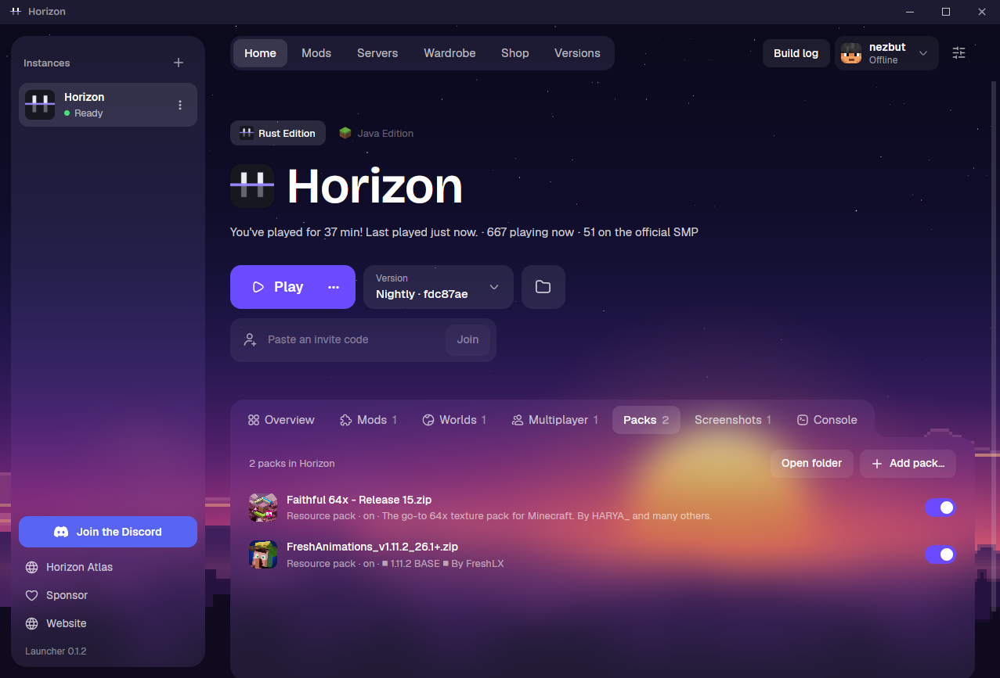

# Horizon Atlas

**Play Horizon offline.** Horizon Atlas is a launcher for [Horizon](https://github.com/horizon-rust/horizon), Minecraft:
Java Edition 26.3 rewritten in Rust. It plays without a Microsoft account sign-in, prepares the game from your own copy
of Minecraft, and keeps up with every Horizon launcher release.

[](https://github.com/nezbut/horizon-atlas/releases/latest)
[](https://github.com/nezbut/horizon-atlas/releases)
[](#install)

**Download:** [Windows](https://github.com/nezbut/horizon-atlas/releases/latest/download/horizon-launcher-setup.exe) ·
[Windows ARM](https://github.com/nezbut/horizon-atlas/releases/latest/download/horizon-launcher-setup-arm64.exe) ·
[Linux (AppImage)](https://github.com/nezbut/horizon-atlas/releases/latest/download/horizon-launcher-linux-x86_64.AppImage) ·
[macOS (Apple Silicon)](https://github.com/nezbut/horizon-atlas/releases/latest/download/horizon-launcher-macos-arm64.dmg) ·
[macOS (Intel)](https://github.com/nezbut/horizon-atlas/releases/latest/download/horizon-launcher-macos-x64.dmg) ·
[all files](https://github.com/nezbut/horizon-atlas/releases/latest)

<p align="center">
  
</p>

> **Unofficial.** Made by a player. Not affiliated with, endorsed by or supported by Horizon's authors, Mojang or
> Microsoft: ask for help in this repository's [issues](https://github.com/nezbut/horizon-atlas/issues), not on
> Horizon's channels. You need your own copy of Minecraft: Java Edition.

## Features

- **Offline profiles, no Microsoft account.** In the **Profile** tab, add your player names, give each its own skin and cape, and pick who plays. From a terminal: `horizon-atlas offline list`, `add`, `select`, `rename`, `remove`, `skin`, `cape` if you installed with `install.sh` on Linux or macOS (it links `horizon-atlas` into `~/.local/bin`); otherwise run the launcher's own program with `offline …`.
- **Beside the official launcher.** Atlas installs as its own program, so the official Horizon launcher can stay installed next to it.
- **Your own Minecraft, found or chosen.** Atlas finds Minecraft 26.3 in the launchers on your computer, or you pick its `26.3.jar` with **Choose jar…**.
- **All of Horizon.** The game is Horizon's, unmodified: your worlds, mods, resource and shader packs, the fast native renderer ([Horizon's README below](#horizon)).
- **Always current.** Each Horizon launcher release becomes an Atlas release, usually within hours, and the launcher updates itself.
- **Signed updates.** Every update is checked against Atlas's signing key before it is installed.

## Install

- **Windows:** run `horizon-launcher-setup.exe` (`horizon-launcher-setup-arm64.exe` on ARM). It installs **Horizon Atlas Launcher** for your user, in `%LOCALAPPDATA%\Programs\Horizon Atlas Launcher`. It is not code-signed, so SmartScreen may say "Windows protected your PC": choose **More info**, then **Run anyway**.
- **Linux (x86-64) and macOS (Apple Silicon)**, from a terminal:

  ```sh
  curl -fsSL https://raw.githubusercontent.com/nezbut/horizon-atlas/main/install.sh | sh
  ```

  It installs for your user only and puts `horizon-atlas` in `~/.local/bin`. Or take the AppImage (Linux) or the `.dmg` (macOS, Intel too) from the links above.
- **macOS:** the app is **Horizon Atlas**. It is not notarized, so macOS may refuse to open it the first time. Right-click it and choose **Open**, or run `xattr -dr com.apple.quarantine "<path to the app>"` (`install.sh` already does this).

### Coming from Atlas 0.1.x

Atlas updates itself to 0.2.0 as usual, and your worlds and settings stay where they are. Your offline names, the one you play as, and their skins and capes are copied into Atlas's own folder when Atlas 0.2.0 first starts, from the data folder it shares with the official Horizon launcher. The official launcher no longer has offline names: if its version 0.2.59 or newer was used to **Play** before that, it may already have removed them from the shared files, and then they can't be brought back.

Atlas 0.1.x also took the official launcher's place; to move it to its own:

- **Windows:** run the new `horizon-launcher-setup.exe`. It installs Horizon Atlas Launcher in its own folder, and its option **Remove the old Horizon Atlas install (from the Horizon Launcher folder)** (ticked) removes the old copy from the official launcher's folder. Your worlds and settings stay. Remove the old copy this way, not with the old "Horizon Launcher" entry in Windows' installed apps. Until you move, Atlas reminds you when it starts (or choose **Don't show again**).
- **Linux:** nothing to do: the menu entry becomes **Horizon Atlas** by itself.
- **macOS:** an update keeps the old app's name (`Horizon`). To get **Horizon Atlas**, quit Atlas first, then install again: `install.sh` replaces the old app in `~/Applications/Horizon Atlas` by itself; with the new `.dmg` or zip, move the old **Horizon** app to the Trash afterwards (unless it is the official launcher, which has the same name). If you pinned the old app to the Dock, you may need to pin the new one again.

## First run

1. Have Minecraft: Java Edition 26.3 installed once, in any launcher (the official one, Prism, Modrinth App and others work).
2. Open Atlas and press **Prepare**. It finds your copy of 26.3 and prepares the game from it. If it cannot, press **Choose jar…** and pick `versions/26.3/26.3.jar` in the folder of the launcher that downloaded 26.3, so that its `libraries` and `assets` are found too.
3. In the **Profile** tab, add a player name (and a skin and a cape, if you like), then press **Play**.

## FAQ

**Do I need to own Minecraft?** Yes. Atlas prepares the game from your own copy of Minecraft: Java Edition 26.3 and never downloads Minecraft for you. The jar must be the 26.3 release, with the `libraries` and `assets` its launcher downloaded next to it; a jar on its own fails with a "Missing …/libraries/…" error.

**Can I play on servers?** In single player, in LAN worlds and on servers that run in offline mode, yes. Online-mode servers (most public ones) check a Microsoft account, and Atlas doesn't support Microsoft sign-in yet, so they turn you away.

**Can I sign in with Microsoft?** Not yet. Atlas keeps its own accounts, apart from the official launcher's, and shows a short note where a Microsoft sign-in would start.

**Will my worlds work?** Horizon opens vanilla saves as they are and upgrades worlds from 1.8 to 26.2.

**Is it safe?** The source is open, every release is built by GitHub Actions from this repository, and the launcher installs an update only if its signature checks out. The Windows warning only means the installer has no paid code-signing certificate.

**Mods and shader packs?** As in Horizon: install them from the launcher's Mods page.

**Can I keep the official Horizon launcher too?** Yes, side by side. Atlas is its own program (Horizon Atlas Launcher on Windows, Horizon Atlas in the Linux menu and on macOS), and both launchers share your worlds and settings. Their accounts stay apart.

## For developers: how Atlas stays in sync

Atlas is a short list of small commits (patches: `choose-jar`, `own-releases`, `own-keys`, `branding`, `offline`, `no-sign-in`, `own-install`) on top of one of Horizon's `launcher@X.Y.Z` tags.
Four times a day a workflow checks for a newer Horizon launcher tag, replays the patches onto it, tests, and publishes a release. If a patch no longer applies, nothing is published and an issue names the patch.
Atlas's versions are its own (`0.x`); each release title says which Horizon launcher it is based on.

The everyday commands are in `Taskfile.yml` ([go-task](https://taskfile.dev)):

- `task check`: every check (formatting, clippy, the launcher's tests, the sync tool's tests, actionlint).
- `task status`: the Horizon launcher tag Atlas is on, a newer one if there is, and Atlas's next version.
- `task rehearse -- <ref>`: replay the patches onto an upstream ref in a scratch clone, leaving yours alone.
- `task clone:sync`: bring your clone's `main` up to date after a sync.
- `task run:scratch`: start the built launcher on scratch folders, away from your real data.

## License

MIT, like Horizon (see [LICENSE](LICENSE)). Horizon is by Ludovic Marie and the Horizon contributors; Atlas is built on their work. See [THIRD_PARTY_NOTICES.md](THIRD_PARTY_NOTICES.md) for other credits.

---

*Below is Horizon's own README, unchanged.*

<p align="center">
  
</p>

<p align="center">
  <a href="https://playhorizon.dev"><b>Website</b></a> ·
  <a href="#download"><b>Download</b></a> ·
  <a href="https://playhorizon.dev/docs/"><b>Docs</b></a> ·
  <a href="https://discord.gg/playhorizon"><b>Discord</b></a> ·
  <a href="ROADMAP.md"><b>Roadmap</b></a> ·
  <a href="#contributing"><b>Contributing</b></a>
</p>

<p align="center">
  <a href="#project-status"></a>
</p>

# Horizon

**Minecraft: Java Edition 26.3, rewritten in Rust.** Your worlds, the same rules and the same terrain as the Java game, checked against it by hundreds of differential tests, in one native program with no Java. Free, open source (MIT) and unofficial: you play it with your own copy of Java Edition.

<p align="center">
  
</p>

## What works today

Everything below is in the current release.

- **The game.** Survival, creative, hardcore and spectator; vanilla world generation in all three dimensions, mobs, villagers, raids, redstone, every command, the HUD and the recipe book. Vanilla saves open as they are, and worlds from 1.8 to 26.2 are upgraded.
- **Multiplayer.** Join vanilla and Horizon servers (online mode included), open a world to LAN, or invite friends with a code from the launcher's Home page.
- **Graphics.** Distant terrain up to 1,024 chunks, graphics presets, HDR and controllers, all off by default where they would change the vanilla look ([settings](https://playhorizon.dev/docs/settings)).
- **Packs.** Resource packs, data packs and shader packs ([below](#mods-and-shader-packs)).
- **Mods.** Content mods and native Rust mods, installed from the launcher ([below](#mods-and-shader-packs)).
- **Servers.** Host one from the launcher, or run `horizon-server` on a VPS ([below](#host-a-server)).
- **The launcher.** It installs and updates the game, prepares its files from your copy of Minecraft, and updates itself.

<table>
  <tr>
    <td width="50%"></td>
    <td width="50%"></td>
  </tr>
  <tr>
    <td width="50%"></td>
    <td width="50%"></td>
  </tr>
</table>

<sub>Nightly 2026-11-05 on a Mac mini (Apple M4 Pro, Metal): vanilla's textures, no mods or shader packs, render distance 32 with distant terrain on.</sub>

## Performance

**Horizon draws more frames per second than Java Edition, and loads faster, on the same machine, world and path.** `tools/perf_bench.py` runs each game in turn, from a fresh world (seed 1234), waiting for the terrain and then flying it over a village, a forest, an ocean and a mountain. Measured on 2026-10-29/30 on an idle Windows 11 machine (Ryzen 7 9800X3D, RTX 5080), Horizon v0.2.97 as the launcher installs it, 1280x720 in a window, VSync off, three games per figure. Frames per second, mean of the four scenes, with the slowest 1% of frames in brackets:

| Render distance | Horizon v0.2.97 | Vanilla 26.3 | Vanilla + mods |
| --- | --- | --- | --- |
| 8 chunks | 3,289 (1,327) | 2,437 (640) | 2,375 (709) |
| 16 chunks | 2,074 (598) | 1,661 (375) | 1,586 (432) |
| 32 chunks | 1,207 (333) | 1,031 (176) | 879 (264) |

"Vanilla + mods" is Sodium, Lithium, FerriteCore and ImmediatelyFast. Horizon reaches the title screen in 2.9–3.2 s against vanilla's 7.5–7.7 s (the modded client's 10.8–11.1 s), loads a scene's chunks 2.9–3.8 times faster, and playing holds a steady working set of 1.1–1.7 GB against 1.9–2.9 GB. Every scene with its confidence interval and the run's load log: [the 2026-10-29 reports](benchmarks/perf/windows-9800x3d-5080-2026-10-29.md). Method, and how to measure your own machine: [docs/benchmark.md](docs/benchmark.md). [playhorizon.dev/benchmarks](https://playhorizon.dev/benchmarks) puts these runs beside a 2016 laptop, a Mac mini and a gaming desktop.

## Download

Get **the Horizon launcher** from [playhorizon.dev](https://playhorizon.dev), or from [the launcher releases](https://github.com/horizon-rust/horizon/releases?q=launcher&expanded=true):

| Platform | File | Needs |
| --- | --- | --- |
| Windows x64 | `horizon-launcher-setup.exe` | Windows 10 or 11, a GPU with Vulkan or DirectX 12 |
| Windows on Arm | `horizon-launcher-setup-arm64.exe` | Windows 11 on Arm |
| macOS, Apple Silicon | `horizon-launcher-macos-arm64.dmg` | macOS 12 or later |
| macOS, Intel | `horizon-launcher-macos-x64.dmg` | macOS 12 or later |
| Linux x86-64 | `horizon-launcher-linux-x86_64.AppImage` or `.tar.gz` | a glibc distribution, X11 or Wayland, a GPU with Vulkan or OpenGL 3.3 |

**You also need a Microsoft account that owns Minecraft: Java Edition.** You sign in with it in the launcher, which plays only with an account that owns the game ([why](docs/microsoft-account.md)). Horizon contains no Minecraft code or assets: an existing install (official launcher, Prism, MultiMC...) is reused, and without one the launcher downloads 26.3 from Mojang for your account. Step by step: [Install and first launch](https://playhorizon.dev/docs/install).

<table>
  <tr>
    <td width="50%"></td>
    <td width="50%"></td>
  </tr>
</table>

## Mods and shader packs

- **Content mods** (`.hmod`): blocks, items, recipes, loot, models and textures, with no code.
- **Native mods** (`.hnmod`): Rust that the launcher compiles into the game for you, with nothing to install.
- **Java mods** (Fabric, NeoForge, Forge) don't run: Horizon has no Java. The launcher carries over the data and assets inside their jars, and imports modpacks (`.mrpack`, CurseForge zips, Prism instances) the same way ([modpacks](https://playhorizon.dev/docs/modpacks)).
- **Shader packs**: Iris/OptiFine-format packs (`shaders/` folders) and Horizon's own WGSL packs, under Video Settings → Shader Packs ([pack format](docs/shaders.md)).

Mods are off by default: a fresh install plays exactly like vanilla 26.3. The launcher's Mods page browses Horizon's registry and Modrinth. [Mods](https://playhorizon.dev/docs/mods) · [make a mod](docs/mods.md).

## Host a server

The launcher's **Servers** page creates, starts, backs up and updates a server, and invites friends. On a VPS, `horizon-server` installs with one command, needs no Java, and takes vanilla 26.3 and Horizon players alike. [Host a server](https://playhorizon.dev/docs/hosting) ([reference](docs/hosting.md)).

## Agent control

AI agents and scripts can play Horizon. `horizon-ctl`, shipped with the game, reads its state as JSON and acts like a player; `horizon-ctl mcp` serves the same commands over MCP.

```sh
horizon-ctl launch --world Survival --seed 5 --wait   # finds the version the launcher installed
horizon-ctl state                                       # position, health, food, target, screen...
horizon-ctl goto -0.5 65 -2.5 --near 2.5                # walks there along a path
horizon-ctl break -1 65 -3                              # mines it; replies with the drops
```

`horizon-ctl help` lists every command. [Agent control](docs/native-client.md#agent-control-horizon-ctl-and-mcp).

## Build from source

Needs Rust 1.90+, Python 3.11+, JDK 25, and on Linux `libasound2-dev libudev-dev`. `horizon-prepare` builds the game's resources from **your own copy** of Java Edition 26.3 (checked against `research-lock.json`) and never downloads it:

1. **Client:** play 26.3 once in the official launcher. Horizon reads `~/.minecraft` (or `--minecraft-dir` / `HORIZON_MINECRAFT_DIR`).
2. **Server jar:** the 26.3 server jar (`downloads.server.url` in `versions/26.3/26.3.json`), passed once with `--server-jar` or `HORIZON_SERVER_JAR`.

```sh
git clone https://github.com/horizon-rust/horizon.git
cd horizon
cargo run --release -p horizon-prepare -- --prepare --server-jar ~/Downloads/server.jar   # needs JDK 25
cargo run --release -p horizon-prepare -- sounds   # optional: sounds from your launcher install
cargo run --release -p horizon-client
```

Prepared files land in the gitignored `.local/`: never commit or share them. Options, controls and architecture: [the native client guide](docs/native-client.md); all developer docs: [docs/README.md](docs/README.md).

## Contributing

Issues and pull requests are welcome: read [CONTRIBUTING.md](CONTRIBUTING.md) (vanilla first, small pull requests), and see [ROADMAP.md](ROADMAP.md) or [playhorizon.dev/hub](https://playhorizon.dev/hub) for what's next. Questions: [Discord](https://discord.gg/playhorizon). Before a pull request, run the self-check and paste its output:

```sh
git config core.hooksPath .githooks
python3 tools/pr_ready.py
```

It runs rustfmt, clippy, the touched crates' tests, the Python tests, the public-tree check and the vanilla harnesses your change affects. Never commit game files, decompiled source or prepared resources.

How Horizon is run (the council, theme groups and their leads, the Horizon Team, moderation): [GOVERNANCE.md](GOVERNANCE.md).

## Project status

**Player-visible gaps: 0 open** of the 833 the [port ledger](tools/port_ledger.py) found, reading every vanilla 26.3 method against Horizon's code: vanilla behaviour a player would notice that Horizon doesn't have yet. By area: Animals [0](https://github.com/horizon-rust/horizon/issues/3512); Monsters and bosses [0](https://github.com/horizon-rust/horizon/issues/3513); Entities, projectiles, vehicles and decorations [0](https://github.com/horizon-rust/horizon/issues/3514); Items, enchantments and inventories [0](https://github.com/horizon-rust/horizon/issues/3515); Blocks, redstone and fluids [0](https://github.com/horizon-rust/horizon/issues/3516); World, world generation and saves [0](https://github.com/horizon-rust/horizon/issues/3517); Screens, HUD and client packets [0](https://github.com/horizon-rust/horizon/issues/3518); Entity and block rendering, models [0](https://github.com/horizon-rust/horizon/issues/3519); Server and players on the server [0](https://github.com/horizon-rust/horizon/issues/3520); Mob AI, villagers and raids [0](https://github.com/horizon-rust/horizon/issues/3521). This number goes down as gaps close (`tools/parity_gaps.py`); the table below says what the harnesses compare.

The table is the project's own audit of what the harnesses compare, subsystem by subsystem: a score says how much of that subsystem the harnesses cover and pass, not that nothing else differs from vanilla. What players still run into: [known issues](docs/known-issues.md).

### What the harnesses compare

Scores: 0 (absent), 0.25 (started), 0.5 (playable, major features missing), 0.75 (mostly complete) or 1 (its harnesses cover the subsystem and pass). Last audited 2026-10-13: the harnesses pass on Linux and macOS. The [port ledger](tools/port_ledger.py) adds a method-by-method view of what is ported.

| Subsystem | Score | Main gaps |
| --- | ---: | --- |
| Window, input and game loop | 1 | None: game loop, options, camera, auto-jump, toggle sprint/sneak and frame limiter match |
| Assets and resources | 1 | None: item models match over 196,290 stacks; the resource pack screen over 3,000 sessions |
| Network protocol and multiplayer | 1 | None: joins vanilla servers; the dedicated server matches vanilla's files, login, configuration, play and command tree; LAN discovery over 462 cases (offline mode only) |
| Chunk storage and palettes | 1 | None: client and saves share paletted containers, identical to vanilla over 266 scenarios |
| Section meshing | 1 | None: 112 scenes and over a million quads identical to vanilla |
| Rendering | 1 | None: entity models, block entity renderers (407 cases) and animations (296), HUD overlays (2,200 states), the recipe book (600), player list, subtitles and world border match |
| Lighting | 1 | None: saved and relit light matches vanilla, slabs and stairs included |
| World generation | 1 | None: 2,352 whole chunks over 225 structure sites, in all three dimensions, identical to vanilla |
| Region files and saves | 1 | None: saves round-trip with vanilla; worlds from 1.8 to 26.2 upgrade as vanilla's DataFixers do |
| Entities and physics | 1 | None: attributes, spawn rules, natural spawning (15,500 cases), raids and patrols (1,900), `finalizeSpawn` (24,000) and mob AI (92 scenarios) match |
| Interaction and inventory | 1 | None: menu clicks over 8,000 sequences; recipe book placement (6,000), buttons (1,200), saved book (1,500), loom and crafter screens (1,600) |
| Menus, HUD and chat | 1 | None: every command (758 over 39,685 inputs), scoreboards (81,000 operations), the player list (872,000 draw calls), chat and its suggestions (3,000 sessions) match |
| Audio | 1 | None: the sound engine, sound events, music, situational music, ambience and subtitles match vanilla |
| Block behaviours and ticking | 1 | None: block updates, random ticks, redstone, dispensers (6,000 cases), crafters (4,000), container spills (4,000), copper golems and the sculk family (435 scenarios) match |

## Licence

[MIT](LICENSE), for the project's original work; dependencies keep their own licences ([notices](THIRD_PARTY_NOTICES.md)). Horizon is made by [Ludovic Marie](https://lu4ovic.com) ([@ludovic111](https://github.com/ludovic111)) and [its contributors](https://github.com/horizon-rust/horizon/graphs/contributors); support it on [GitHub Sponsors](https://github.com/sponsors/ludovic111).

NOT AN OFFICIAL MINECRAFT PRODUCT. NOT APPROVED BY OR ASSOCIATED WITH MOJANG OR MICROSOFT. Minecraft is a trademark of Mojang Synergies AB; its code and assets belong to Mojang and Microsoft under the [Minecraft EULA](https://www.minecraft.net/en-us/eula).
