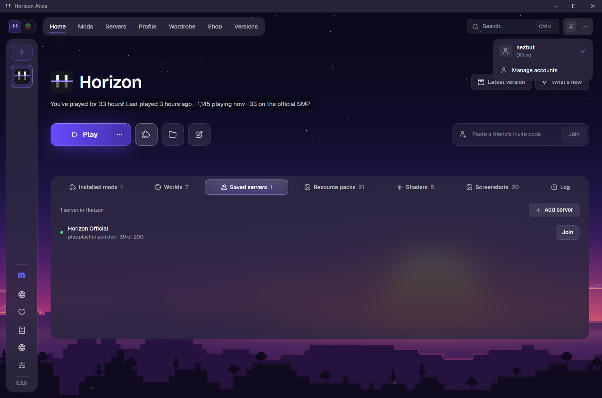
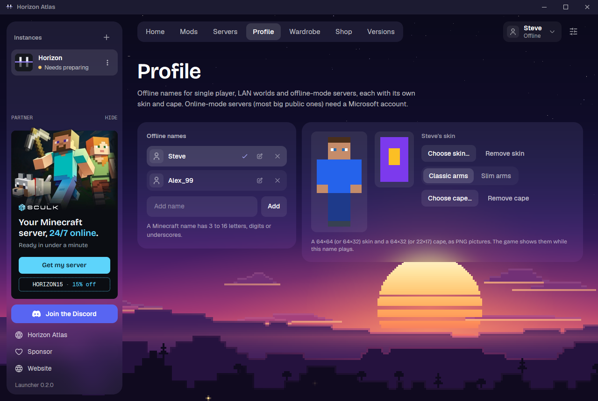

<h1 align="center">Horizon Atlas</h1>

<p align="center">
  <b>Играйте в <a href="https://github.com/horizon-rust/horizon">Horizon</a> без аккаунта Microsoft.</b><br>
  Лаунчер для Horizon, Minecraft: Java Edition 26.3, переписанного на Rust: офлайн-имена со своими скинами и плащами,
  игра из вашей собственной копии Minecraft и каждый новый релиз лаунчера Horizon в течение нескольких часов.
</p>

<p align="center">
  <a href="https://github.com/nezbut/horizon-atlas/releases/latest/download/horizon-launcher-setup.exe"></a>
</p>

<p align="center">
  Другие системы:
  <a href="#linux-и-macos">Linux</a> ·
  <a href="#linux-и-macos">macOS</a> ·
  <a href="https://github.com/nezbut/horizon-atlas/releases/latest/download/horizon-launcher-setup-arm64.exe">Windows на ARM</a> ·
  <a href="https://github.com/nezbut/horizon-atlas/releases/latest">все файлы</a>
</p>

<p align="center">
  <a href="#windows">Как установить</a> · <a href="#первый-запуск">Первый запуск</a> · <a href="#вопросы-и-ответы">Вопросы</a> · <a href="README.md"><b>English</b></a>
</p>

<p align="center">
  <a href="https://github.com/nezbut/horizon-atlas/releases/latest"></a>
  <a href="https://github.com/nezbut/horizon-atlas/releases"></a>
  
  
  <a href="#лицензия"></a>
</p>

<p align="center">
  
</p>

> **Неофициальный.** Сделан игроком. Не связан с авторами Horizon, Mojang или Microsoft и не поддерживается ими: с
> вопросами приходите в [issues](https://github.com/nezbut/horizon-atlas/issues) этого репозитория, а не в каналы
> Horizon. Нужна ваша собственная копия Minecraft: Java Edition.

## Что умеет

- **Офлайн-профили без аккаунта Microsoft.** Во вкладке **Профиль** добавьте имена игроков, дайте каждому свой скин и
  плащ и выберите, кто играет. Из терминала: `horizon-atlas offline list`, `add`, `select`, `rename`, `remove`, `skin`,
  `cape`, если вы ставили через `install.sh` на Linux или macOS (он кладёт `horizon-atlas` в `~/.local/bin`); иначе
  запускайте саму программу лаунчера с `offline …`.
- **Рядом с официальным лаунчером.** Atlas ставится отдельной программой, официальный лаунчер Horizon можно оставить.
- **Ваш Minecraft, найденный или выбранный.** Atlas сам находит Minecraft 26.3 в лаунчерах на компьютере, или вы
  выбираете его `26.3.jar` кнопкой **Выбрать jar…**.
- **Весь Horizon.** Игра — это Horizon без изменений: ваши миры, моды, ресурспаки и шейдеры, быстрый нативный рендер.
- **Всегда свежий.** Каждый релиз лаунчера Horizon становится релизом Atlas, обычно за несколько часов. Лаунчер
  показывает, что вышла новая версия, и обновляется по кнопке **Обновить**; включите в настройках **Обновлять лаунчер
  автоматически**, и он будет обновляться сам.
- **Подписанные обновления.** Перед установкой каждое обновление проверяется по ключу подписи Atlas.

## Установка

### Windows

1. Скачайте **[horizon-launcher-setup.exe](https://github.com/nezbut/horizon-atlas/releases/latest/download/horizon-launcher-setup.exe)**
   (фиолетовая кнопка вверху качает тот же файл). Если у компьютера процессор ARM (Snapdragon и похожие: в
   «Параметры» → «Система» → «О системе» в строке «Тип системы» написано «процессор на базе ARM»), берите
   **[horizon-launcher-setup-arm64.exe](https://github.com/nezbut/horizon-atlas/releases/latest/download/horizon-launcher-setup-arm64.exe)**.
2. Откройте скачанный файл. Windows может написать **«Система Windows защитила ваш компьютер»**: у установщика просто
   нет платного сертификата подписи кода. Нажмите **«Подробнее»**, затем **«Выполнить в любом случае»**.
3. Нажмите **Установить**. Установщик ставит **Horizon Atlas Launcher** только для вашей учётной записи Windows, в
   `%LOCALAPPDATA%\Programs\Horizon Atlas Launcher`, без прав администратора, и добавляет его в меню «Пуск» (и на
   рабочий стол, если отмечен **Ярлык на рабочем столе**).
4. Нажмите **Запустить Horizon Atlas** и переходите к [первому запуску](#первый-запуск).

Скачивать его заново потом не нужно: Atlas показывает, что вышла новая версия, и кнопка **Обновить** в его боковой
панели её ставит (или включите в настройках **Обновлять лаунчер автоматически**).

### Linux и macOS

На Linux (x86-64) и macOS (Apple Silicon) в терминале:

```sh
curl -fsSL https://raw.githubusercontent.com/nezbut/horizon-atlas/main/install.sh | sh
```

Он ставит Atlas только для вашего пользователя и кладёт `horizon-atlas` в `~/.local/bin`. Или скачайте файл сами:
[AppImage](https://github.com/nezbut/horizon-atlas/releases/latest/download/horizon-launcher-linux-x86_64.AppImage) для
Linux, `.dmg` для [Apple Silicon](https://github.com/nezbut/horizon-atlas/releases/latest/download/horizon-launcher-macos-arm64.dmg)
или [Intel](https://github.com/nezbut/horizon-atlas/releases/latest/download/horizon-launcher-macos-x64.dmg) для macOS.

На macOS приложение называется **Horizon Atlas**. Оно не нотаризовано, поэтому macOS может не открыть его в первый
раз: нажмите на него правой кнопкой и выберите **Открыть** или выполните
`xattr -dr com.apple.quarantine "<путь к приложению>"` (`install.sh` делает это сам).

## Первый запуск

1. Один раз установите Minecraft: Java Edition 26.3 в любом лаунчере (подойдут официальный, Prism, Modrinth App и
   другие).
2. Откройте Atlas и нажмите **Подготовить**. Он найдёт вашу копию 26.3 и подготовит из неё игру. Если не найдёт,
   нажмите **Выбрать jar…** и укажите `versions/26.3/26.3.jar` в папке того лаунчера, который скачал 26.3: тогда
   найдутся и его `libraries` и `assets`.
3. Во вкладке **Профиль** добавьте имя игрока (и, если хотите, скин и плащ), затем нажмите **Играть**.

## Новое в 0.2.0: свой офлайн-режим Atlas

С версии 0.2.59 официальный лаунчер Horizon играет только с аккаунтом Microsoft, у которого куплен Minecraft: офлайн-
имён в нём больше нет (сама игра по-прежнему играет офлайн). С 0.2.0 Atlas не включает офлайн-режим официального
лаунчера, а держит офлайн-игру в своём собственном слое:

- **Вкладка «Профиль»** (новая): несколько офлайн-имён, играет одно из них. У каждого имени свой скин, с классическими
  или тонкими руками, и свой плащ, в виде PNG-картинок. Там же имена добавляются, переименовываются и удаляются.
- **Меню аккаунта** (справа вверху) показывает, кто играет, и переключает ваши имена.
- **Свои данные Atlas:** имена, скины, плащи и аккаунты Atlas лежат в собственной папке Atlas, отдельно от данных
  официального лаунчера. Имена, скины и плащи из Atlas 0.1.x копируются туда при первом запуске
  ([подробнее](#переход-с-atlas-01x)).
- **Своя установка:** Atlas ставится рядом с официальным лаунчером, а не поверх него ([Установка](#установка)).

Свой скин и плащ в игре видите вы; другие игроки видят скин по умолчанию.

<p align="center">
  
</p>

### Переход с Atlas 0.1.x

Atlas обновляется до 0.2.0 как обычно, ваши миры и настройки остаются на месте. Офлайн-имена, выбранное имя и их скины
и плащи копируются в собственную папку Atlas при первом запуске Atlas 0.2.0 из папки данных, общей с официальным
лаунчером Horizon. В официальном лаунчере офлайн-имён больше нет: если до этого в нём (версии 0.2.59 или новее)
нажимали **Играть**, он мог уже удалить их из общих файлов, и тогда вернуть их не получится.

Atlas 0.1.x к тому же занимал место официального лаунчера; чтобы перенести его в своё:

- **Windows:** запустите новый `horizon-launcher-setup.exe`. Он поставит Horizon Atlas Launcher в отдельную папку, а
  его галочка **Удалить старую установку Horizon Atlas (из папки Horizon Launcher)** (отмечена) уберёт старую копию из
  папки официального лаунчера. Миры и настройки останутся. Удаляйте старую копию именно так, а не через старую запись
  «Horizon Launcher» в установленных приложениях Windows. Пока вы не переехали, Atlas напоминает об этом при запуске
  (или нажмите **Больше не показывать**).
- **Linux:** ничего делать не нужно: пункт меню сам станет **Horizon Atlas**.
- **macOS:** обновление оставляет старое имя приложения (`Horizon`). Чтобы получить **Horizon Atlas**, сначала закройте
  Atlas, затем установите заново: `install.sh` сам заменит старое приложение в `~/Applications/Horizon Atlas`; с новым
  `.dmg` или zip потом переместите старое приложение **Horizon** в Корзину (если это не официальный лаунчер, у него то
  же имя). Если старое приложение было закреплено в Dock, новое, возможно, придётся закрепить заново.

## Вопросы и ответы

**Нужно ли покупать Minecraft?** Да. Atlas готовит игру из вашей собственной копии Minecraft: Java Edition 26.3 и
никогда не скачивает Minecraft за вас. Нужен jar именно релиза 26.3 вместе с `libraries` и `assets`, которые рядом с
ним скачал его лаунчер; одинокий jar выдаст ошибку «Missing …/libraries/…».

**Можно играть на серверах?** В одиночной игре, в мирах по локальной сети и на серверах в офлайн-режиме — да. Серверы в
онлайн-режиме (большинство публичных) проверяют аккаунт Microsoft, а вход через Microsoft Atlas пока не поддерживает,
поэтому они вас не пустят. Horizon — это Minecraft 26.3, так что сервер должен пускать игроков 26.3 (сервер 26.3 или
более старый со свежим ViaVersion). Другие игроки увидят ваш офлайн-скин, только если на сервере есть плагин скинов.

**Можно войти через Microsoft?** Пока нет. У Atlas свои аккаунты, отдельно от официального лаунчера, а там, где
начинался бы вход через Microsoft, он показывает короткое пояснение.

**Мои миры будут работать?** Horizon открывает ванильные сохранения как есть и обновляет миры с 1.8 до 26.2.

**Это безопасно?** Исходный код открыт, каждый релиз собирает GitHub Actions из этого репозитория, а лаунчер ставит
обновление, только если его подпись верна. Предупреждение Windows значит лишь, что у установщика нет платного
сертификата подписи кода.

**Моды и шейдеры?** Как в Horizon: ставьте их со страницы **Моды** в лаунчере.

**Можно оставить и официальный лаунчер Horizon?** Да, рядом. Atlas — отдельная программа (Horizon Atlas Launcher на
Windows, Horizon Atlas в меню Linux и на macOS), оба лаунчера пользуются одними мирами и настройками. Аккаунты у них
раздельные.

## Для разработчиков

Как Atlas держится в синхронизации с Horizon и какие команды есть в `Taskfile.yml`, описано в
[английском README](README.md#for-developers-how-atlas-stays-in-sync).

## Лицензия

Atlas следует лицензии Horizon. Начиная с лаунчера Horizon 0.2.69 (Atlas 0.2.9) это GNU Lesser General Public License
версии 3 или любой более поздней: [LICENSE](LICENSE), а GNU GPL, на которой она построена, лежит в
[LICENSES/GPL-3.0.txt](LICENSES/GPL-3.0.txt). Atlas 0.2.8 и более ранние, собранные на MIT-релизах Horizon, остаются
под лицензией MIT ([LICENSES/MIT.txt](LICENSES/MIT.txt)).

Horizon создали Ludovic Marie и участники проекта Horizon; Atlas построен на их работе и меняет только лаунчер. Его
изменения — это коммиты `patch:` и `atlas:` в этом репозитории. Остальные благодарности — в
[THIRD_PARTY_NOTICES.md](THIRD_PARTY_NOTICES.md).
